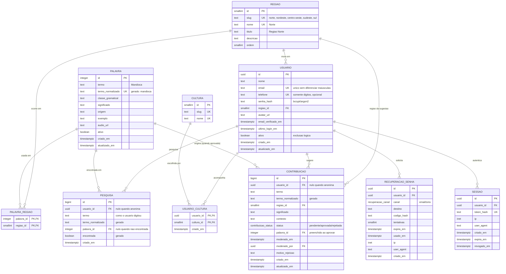

# Banco de dados — VivaLíngua

Modelagem PostgreSQL da aplicação VivaLíngua (Projeto Integrador — diversidade
linguística brasileira).

O modelo foi escrito para substituir o armazenamento que o site usava em
`localStorage`, mantendo os mesmos campos do front-end.

## Estrutura do projeto

```text
Projeto-Integrador/
├── index.html                  # Página inicial (busca de palavras)
├── imagem - VivaL.jpg          # Imagem de destaque do projeto
├── LICENSE
├── .gitattributes
├── .gitignore
├── .env.example                # Modelo das variáveis de ambiente
├── package.json                # Dependências das funções serverless
├── package-lock.json           # Versões travadas das dependências
├── banco/                      # Modelagem PostgreSQL
│   ├── 01-schema.sql           # Tipos, tabelas, índices, triggers, funções e views
│   ├── 02-seed.sql             # Carga inicial (regiões, culturas, palavras)
│   └── README.md               # Documentação do banco (este arquivo)
├── api/                        # Backend (Vercel Functions)
│   ├── _lib/                   # Helpers compartilhados (não viram endpoints)
│   │   ├── db.js               # Conexão com o PostgreSQL (Neon)
│   │   ├── http.js             # Respostas, corpo e IP do cliente
│   │   ├── reset.js            # Códigos de recuperação de senha
│   │   ├── session.js          # Cookie e tabela sessao
│   │   ├── usuario.js          # Consulta completa do usuário
│   │   └── validation.js       # E-mail, telefone e força de senha
│   ├── auth/
│   │   ├── register.js         # POST /api/auth/register
│   │   ├── login.js            # POST /api/auth/login
│   │   ├── logout.js           # POST /api/auth/logout
│   │   ├── me.js               # GET  /api/auth/me
│   │   ├── forgot.js           # POST /api/auth/forgot
│   │   ├── verify-code.js      # POST /api/auth/verify-code
│   │   ├── reset.js            # POST /api/auth/reset
│   │   └── change-password.js  # POST /api/auth/change-password
│   ├── searches.js             # GET/POST /api/searches
│   ├── contributions.js        # GET/POST /api/contributions
│   └── profile.js              # GET/PATCH /api/profile
└── src/
    ├── css/
    │   └── style.css           # Estilos globais da aplicação
    ├── js/
    │   ├── api.js              # Cliente fetch da API
    │   ├── auth.js             # Cadastro, login, sessão, perfil e senhas
    │   ├── historico.js        # Histórico de pesquisas e contribuições
    │   └── script.js           # Busca, banco de palavras e contribuições
    └── paginas/
        ├── cadastro.html
        ├── codigo.html         # Verificação do código de recuperação
        ├── editar-perfil.html
        ├── esqueci-senha.html
        ├── historicos.html
        ├── login.html
        ├── nova-senha.html
        ├── perfil.html
        └── trocar-senha.html
```

| Arquivo | Conteúdo |
|---|---|
| `01-schema.sql` | Criação do esquema: tipos, tabelas, índices, triggers, funções e views |
| `02-seed.sql` | Carga inicial: 5 regiões, 6 culturas, 28 palavras e 34 associações região↔palavra |

```bash
createdb vivalingua
psql -d vivalingua -f 01-schema.sql
psql -d vivalingua -f 02-seed.sql
```

Requisitos: **PostgreSQL 13+** (usa `gen_random_uuid()` nativo) e **nenhuma
extensão**. Os dois scripts são idempotentes: podem ser executados várias vezes
sem duplicar dados.

---

## Backend na Vercel

O front-end continua sendo HTML, CSS e JS. O "servidor" são as funções em
`api/`, executadas pela Vercel, e os dados ficam no PostgreSQL (Neon/Vercel
Postgres). O `localStorage` agora guarda apenas cache de exibição (tema,
avatar e nome no header); a sessão de verdade é o cookie `HttpOnly`
`vivalingua_session`, validado contra a tabela `sessao`.

### Variáveis de ambiente

| Variável | Obrigatória | Uso |
|---|---|---|
| `DATABASE_URL` | sim | Connection string do PostgreSQL |
| `AUTH_SECRET` | recomendada | Chave usada no hash dos códigos de recuperação |
| `RESEND_API_KEY` | não | Envio real do código por e-mail (Resend) |
| `EMAIL_FROM` | não | Remetente usado no envio por e-mail |
| `DEMO_MOSTRAR_CODIGO` | não | `true` devolve o código no JSON quando não há envio real |

Copie `.env.example` para `.env.local` e preencha os valores. O `.env.local`
não deve ser commitado.

### Rodar localmente

```bash
npm install
npx vercel dev
```

### Deploy

1. Importe o repositório na Vercel.
2. Framework Preset: **Other**; Build Command vazio; Output Directory: `.`.
3. Cadastre as variáveis de ambiente (`DATABASE_URL`, `AUTH_SECRET`).
4. Rode os scripts SQL no banco (veja acima) e faça o deploy.

Ou pelo terminal:

```bash
npx vercel link
npx vercel env add DATABASE_URL
npx vercel env add AUTH_SECRET
npx vercel --prod
```

### Endpoints

| Método | Rota | Função |
|---|---|---|
| `POST` | `/api/auth/register` | Cria a conta com senha em bcrypt |
| `POST` | `/api/auth/login` | Valida a senha e cria a sessão (cookie) |
| `POST` | `/api/auth/logout` | Revoga a sessão atual |
| `GET` | `/api/auth/me` | Usuário logado (ou `null`) |
| `POST` | `/api/auth/forgot` | Gera o código de recuperação (15 min) |
| `POST` | `/api/auth/verify-code` | Confere o código antes da troca |
| `POST` | `/api/auth/reset` | Troca a senha usando o código |
| `POST` | `/api/auth/change-password` | Troca a senha do usuário logado |
| `GET`/`POST` | `/api/searches` | Histórico de pesquisas do usuário |
| `GET`/`POST` | `/api/contributions` | Histórico e envio de contribuições |
| `GET`/`PATCH` | `/api/profile` | Consulta e edição do perfil |

As pesquisas exigem login. As contribuições podem ser enviadas anonimamente
(`usuario_id` nulo), mas só aparecem no histórico quando há sessão.

### Recuperação de senha

Sem `RESEND_API_KEY`, o código é gravado apenas no log da função e, se
`DEMO_MOSTRAR_CODIGO=true`, também é devolvido na resposta para fins de
demonstração. Em produção real, configure o Resend e deixe
`DEMO_MOSTRAR_CODIGO=false`.

---

## Diagrama entidade-relacionamento



---

## De onde vinha cada tabela (antes da API)

A tabela abaixo registra a migração do armazenamento antigo em `localStorage`
para o banco. Hoje o acesso passa pelas funções em `api/`, mas os campos
continuam os mesmos.

| Antes (front-end) | Chave / campo | Virou no banco |
|---|---|---|
| `auth.js` — `vivalingua_users` | `{ name, region, email, phone, password, cultura, createdAt }` | `usuario` + `usuario_cultura` + `senha_hash` |
| `auth.js` — `vivalingua_session` | `{ name, email }` | `sessao` (com token de verdade) |
| `auth.js` — `vivalingua_avatar` | Data URL base64 | `usuario.avatar_url` |
| `auth.js` — `vivalingua_reset_email` | e-mail pendente do fluxo | `recuperacao_senha` |
| `script.js` — `vivalingua_searches` | `{ termo, data }` | `pesquisa` |
| `script.js` — `vivalingua_contributions` | `{ palavra, regiao, significado, contexto, data }` | `contribuicao` |
| `script.js` — `bancoPalavras` | `{ palavra, classe, regiao, significado, origem, exemplo }` | `palavra` + `palavra_regiao` |
| `script.js` — `regioes` (mapa) | `{ titulo, descricao }` | `regiao` |
| `editar-perfil.html` — `<select id="editCultura">` | 6 opções | `cultura` |
| `historicos.html` (abas) | listas em `localStorage` | views `vw_historico_pesquisas` / `vw_historico_contribuicoes` |

### Compatibilidade da normalização

A função `fn_normalizar_termo()` reproduz exatamente o que o front-end faz
(`toLowerCase` + remoção de acentos + separadores virando `_`), então as chaves
geradas pelo banco são **iguais** às do objeto `bancoPalavras`:

```
"Pai d’égua" -> pai_d_egua      "Rolê" -> role
"Égua"       -> egua            "Bão"  -> bao
"Mundiça"    -> mundica         "Tchê" -> tche
```

---

## Decisões de modelagem

**Palavras e regiões (N:N).** Uma palavra pode ser usada em várias regiões
(`mandioca` em todas, `macaxeira` só no Norte e Nordeste). O rótulo exibido no
site é derivado por `fn_regioes_label()`, que devolve `Todo o Brasil` quando a
palavra ocorre nas 5 regiões — em vez de guardar esse texto solto no banco.

**`termo` vs `termo_normalizado`.** Hoje o histórico guarda só o termo já
normalizado, perdendo o que o usuário digitou. O modelo guarda os dois: o texto
original (exibição) e a chave normalizada (busca), esta última gerada
automaticamente pelo banco.

**Contribuições moderadas.** A tabela tem `status`, `moderado_em`,
`moderado_por` e `motivo_rejeicao`. Uma contribuição só pode apontar para um
verbete (`palavra_id`) quando está `aprovada` — garantido por `CHECK`, o que
permite aprovar uma sugestão e publicá-la no banco de palavras.

**Segredos nunca em texto puro.** `usuario.senha_hash`, `recuperacao_senha.codigo_hash`
e `sessao.token_hash` guardam apenas hashes (bcrypt/argon2 para senhas; SHA-256
para tokens e códigos). O código de 4–6 dígitos é curto, então controle
`tentativas` e `expira_em`.

**E-mail e telefone como login.** O site aceita e-mail *ou* telefone. Ambos são
únicos: `UNIQUE (lower(email))` e índice parcial `UNIQUE (telefone) WHERE telefone
IS NOT NULL`. O telefone é gravado só com dígitos, como o `normalizePhone()` do
front-end.

**Exclusão lógica.** `usuario.ativo` evita apagar histórico de pesquisas e
contribuições. Onde a exclusão é real, as FKs usam `ON DELETE CASCADE`
(dados do próprio usuário) ou `ON DELETE SET NULL` (autoria).

**Índices.** Os históricos sempre são lidos "do mais recente para o mais antigo
de um usuário", então: `(usuario_id, criado_em DESC)`. A moderação lê por
`(status, criado_em DESC)`.

**Views prontas para as telas.** As abas de `historicos.html` podem ser
reproduzidas com uma consulta direta:

```sql
-- Aba "Palavras pesquisadas" de um usuário
SELECT termo, encontrada, palavra, regioes, criado_em
FROM vw_historico_pesquisas
WHERE usuario_id = $1
ORDER BY criado_em DESC;

-- Aba "Contribuições de palavras"
SELECT termo, regiao, significado, contexto, status, criado_em
FROM vw_historico_contribuicoes
WHERE usuario_id = $1
ORDER BY criado_em DESC;

-- Resultado da busca em index.html
SELECT * FROM vw_palavra_completa WHERE termo_normalizado = fn_normalizar_termo($1);
```

---

## Pontos de atenção para a implementação

1. **Limites de histórico.** A API guarda todas as pesquisas e contribuições,
   mas as leituras usam `LIMIT 30` e `LIMIT 50`, como o site fazia antes. Para
   paginar, troque por `LIMIT`/`OFFSET` com um parâmetro de página.
2. **Senhas.** A API grava apenas o hash bcrypt (custo 10) e valida a força da
   senha no servidor; o front-end repete a validação apenas para dar feedback
   rápido.
3. **Recuperação de senha.** Implementada em `api/auth/*`: o código anterior é
   invalidado, o novo é guardado como HMAC-SHA256, expira em 15 minutos e
   permite no máximo 5 tentativas.
4. **Sessão.** Cookie opaco `HttpOnly` + tabela `sessao`. O logout revoga a
   sessão atual; a troca/redefinição de senha revoga as demais sessões.
5. **Avatar.** O front-end ainda guarda a imagem em base64 no `localStorage`
   (por dispositivo). Para persistir por perfil, use o Vercel Blob e grave a
   URL em `usuario.avatar_url`.
6. **Rate limiting.** Login e recuperação de senha ainda não têm limite de
   requisições por IP. Para produção, use Upstash Redis/Vercel KV na frente
   dessas rotas.
7. **Busca por texto.** Para busca "contém" no significado, um índice GIN com
   `to_tsvector('portuguese', significado)` é o próximo passo natural — não foi
   incluído para não quebrar a compatibilidade de instalações sem configuração
   de idioma.

---

## Validação

O esquema e o seed foram executados em um PostgreSQL 18 real, do zero:

- `01-schema.sql` rodou duas vezes sem erro (idempotente);
- `02-seed.sql` inseriu 5 regiões, 6 culturas, 28 palavras e 34 associações;
  na segunda execução inseriu `0` linhas;
- teste funcional completo (usuário, preferências, pesquisas encontradas e não
  encontradas, contribuição pendente → aprovada, código de recuperação, sessão)
  executado com sucesso em transação revertida;
- 10 restrições verificadas (e-mail duplicado com maiúsculas, telefone
  duplicado, formato de e-mail, termo duplicado normalizado, significado vazio,
  vínculo de contribuição pendente, termo vazio, FK de recuperação, dois códigos
  ativos, sessão já expirada) — todas bloquearam o que deveriam bloquear;
- trigger de `atualizado_em` confirmado entre transações distintas.
